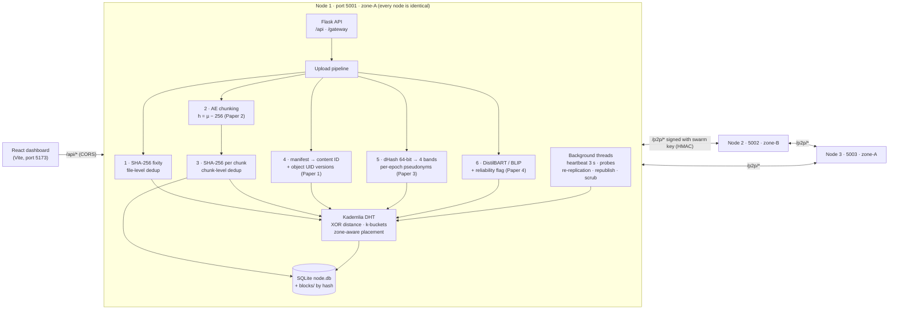

# Smart P2P Storage with AI-Based Duplicate Detection and File Summarization

A decentralized peer-to-peer storage system. Every node runs the same **Flask + SQLite** app and
there is **no central server**. A **React (Vite)** dashboard talks to any node you choose.

- Kademlia-style DHT (XOR distance, k-buckets) with **zone-aware** replication to k peers
- **AE content-defined chunking** with the corrected parameter rule from the base paper, SHA-256 content addressing
- Network-wide **exact dedup** (whole-file and chunk level) through the DHT
- **Near-duplicate images**: 64-bit dHash + Hamming threshold, LSH bands as DHT keys, per-epoch pseudonyms
- **AI on the uploading node only**: DistilBART summaries and BLIP captions, shared with peers via the DHT
- Heartbeats, re-replication, republish, integrity scrub, SHA-256 verification of every chunk and file
- Optional **convergent encryption** (`--encrypt`) and a **private swarm key** on every node-to-node request

Base paper: **Gregoriadis et al., "Benchmarking Content-Defined Chunking Algorithms for Data Deduplication"
(arXiv:2610.13704)**. Ideas from the three other uploaded papers are mapped in
[docs/PAPER_MAPPING.md](docs/PAPER_MAPPING.md).

```
smart-p2p-storage/
├── backend/
│   ├── node.py              # Flask app = one P2P node (/p2p/* signed, /api/* for the UI)
│   ├── config.py            # command-line options
│   ├── core/service.py      # upload pipeline, download, near-dups, heartbeats, repair
│   ├── p2p/dht.py           # Kademlia: node ids, XOR, k-buckets, iterative lookup, store/get
│   ├── p2p/security.py      # swarm-key HMAC, convergent encryption, pseudonyms
│   ├── p2p/framing.py       # batch transfer of many chunks per request
│   ├── storage/chunking.py  # FSC, AE (corrected + legacy), Gear     <- Paper 2
│   ├── storage/store.py     # SQLite metadata + blockstore on disk
│   ├── dedup/dhash.py       # dHash, Hamming distance, LSH bands
│   ├── ai/engine.py         # DistilBART / BLIP (+ labelled fallbacks)
│   └── metrics/text_metrics.py  # ROUGE-1/2/L, METEOR, Contra-Acc
├── frontend/                # React + Vite dashboard (npm run dev -> http://localhost:5173)
├── eval/                    # evaluation scripts -> eval/results/*.json|md (shown in the dashboard)
├── scripts/run_nodes.py     # start N nodes on one laptop
├── scripts/demo.py          # 9-step viva demo
├── scripts/seed_samples.py  # sample files for the dashboard
├── docs/                    # paper mapping, architecture diagram, viva questions
└── .vscode/                 # launch configs (debug 3 nodes) + tasks (start everything)
```

---

## 1. Setup in VS Code (Windows, macOS or Linux)

You need **Python 3.10+**, **Node.js 20 LTS or newer** (22 recommended), and VS Code with the *Python* extension.

1. `File → Open Folder…` → choose `smart-p2p-storage`.
2. Open a terminal (`Ctrl+``) and create a virtual environment:

   ```bash
   # Windows (PowerShell)
   python -m venv .venv
   .venv\Scripts\Activate.ps1
   # macOS / Linux
   python3 -m venv .venv
   source .venv/bin/activate
   ```
   VS Code will ask "use this environment?" — click **Yes** (or `Ctrl+Shift+P → Python: Select Interpreter → .venv`).

3. Install Python packages:

   ```bash
   pip install -r requirements.txt          # full project incl. torch + transformers (~2 GB with models)
   # or, quick start without the neural models (fallbacks are used and clearly labelled):
   pip install -r requirements-core.txt
   ```
   The first upload of a text file or image downloads DistilBART (~1.2 GB) and BLIP (~1 GB) from Hugging Face once.

4. Install the dashboard:

   ```bash
   cd frontend
   npm install
   cd ..
   ```

## 2. Run 3 nodes on one laptop

**Option A — one terminal (easiest):**

```bash
python scripts/run_nodes.py --fresh        # node1 :5001 zone-A, node2 :5002 zone-B, node3 :5003 zone-A
```

**Option B — three terminals** (shows that nodes really are independent):

```bash
python backend/node.py --port 5001 --name node1 --zone zone-A
python backend/node.py --port 5002 --name node2 --zone zone-B --bootstrap 127.0.0.1:5001
python backend/node.py --port 5003 --name node3 --zone zone-A --bootstrap 127.0.0.1:5001
```

**Option C — VS Code debugger:** Run and Debug panel → **"All 3 nodes"** (breakpoints work in every node).

Then start the React dashboard in a **second terminal**:

```bash
cd frontend
npm run dev            # opens http://localhost:5173
```

Pick a node at the top right (5001/5002/5003). You can also open one tab per node with
`http://localhost:5173/?node=http://127.0.0.1:5002`. `Terminal → Run Task → "Start everything"` starts nodes and dashboard together.

Useful node options: `--k 3` (replicas), `--chunker gear|fsc|ae`, `--chunk-size 2048`,
`--hamming 8`, `--encrypt`, `--no-ai`, `--swarm-key <secret>` (must be the same on all nodes).
With `run_nodes.py`, put node options after `--`, for example `python scripts/run_nodes.py --fresh -- --encrypt`.

## 3. Demo (for the viva)

Stop other nodes first (the demo starts its own on 5001–5003):

```bash
python scripts/demo.py           # press Enter between steps
python scripts/demo.py --auto    # no pauses
```

Steps: Kademlia join → upload + AI summary → exact duplicate at another node → edited version
(chunk dedup, **AE reuses 7/9 chunks vs FSC 1/9**) → resized JPEG found as near-duplicate (Hamming 1)
→ where a chunk lives (XOR + zones) → **kill node2**, re-replication, download still works → **corrupt a
block** on disk, hash check catches it → restart node2. The nodes stay up afterwards so you can show the dashboard.
`python scripts/seed_samples.py` fills a running network with sample files.

## 4. Evaluation (same metrics as the papers)

```bash
python eval/eval_chunking.py     # Paper 2: throughput, c̄, s, Max Err, Max CV, dedup ratio, storage savings (β=64)
python eval/eval_neardup.py      # dHash recall / band-recall / false positives under 10 transformations
python eval/eval_privacy.py      # Paper 3: SAGE-Known-lite record/query accuracy, with and without rotation
python eval/eval_ai.py           # Paper 4: ROUGE-1/2/L, METEOR, Contra-Acc, 64x64 stress test; ROUGE of summaries
python eval/eval_network.py      # Paper 1: R = S/t ingest + recovery, block-stat P50/P90, C_raw/r  (nodes must run)
```

Results go to `eval/results/` (`.json` + `.md`, plus `dedup_ratio.png`) and appear in the dashboard's **Evaluation** tab.
Use `--dir your_folder` with `eval_chunking.py` / `eval_neardup.py` to test your own files and photos.
Run `eval_ai.py --vqa` after installing transformers to answer the Contra-Acc questions with BLIP-VQA.

### Results measured while building this (Python 3.13, one laptop)

| What | Ours | Paper |
|---|---|---|
| AE on RAND, µ = 2048: mean / std | 2056 / 254 B | 2048 / 252 B (Table VIII) |
| Legacy AE formula, chunks too small by | 11.8 – 38.9 % | 13 – 39 % |
| AE at µ = 2 KiB: Max CV / best storage savings | 0.31 / 0.77 | 0.31 / 0.89 |
| Insert one sentence: chunks reused | AE 7/9, FSC 1/9 | (boundary-shift problem, Fig. 3) |
| Recovery R = S/t on another node (16 MB) | 36 – 41 MB/s (localhost) | 182 – 368 MB/s (Pi 5 + NVMe, LAN) |
| Block-stat P50 / P90 | ≈0.1 / 0.15–0.9 ms (SSD) | 14–30 / 15–88 ms |
| dHash recall at T = 10 (resize, JPEG, blur) | 1.00, 0 false positives | – |
| dHash recall at T = 10 (5 % crop / 3° rotation / flip) | 0.58 / 0.56 / 0.00 | – |
| SAGE-lite record accuracy, top-10 index, 5 % known | 60.7 % → 43.9 % with rotation ×16 | up to 84.3 % (1 % known) |
| SAGE-lite on our band index | near the 34 % majority baseline (25 % of records reachable) | – |

The AI rows in `eval/results/ai.md` were produced with the **fallback** models, because torch was not available while building this.
Re-run `python eval/eval_ai.py` after `pip install -r requirements.txt` to get real BLIP / DistilBART numbers for your report.

## 5. Architecture



DHT keys: `file:<id>` manifest · `fixity:<sha256>` → file id · `prov:<chunk>` holders · `band:<i>:<16 bits>` near-dup
index · `ai:<id>` summary/caption · `obj:<uid>` versions.

## 6. Deploy on Render

`render.yaml` is a Render Blueprint that creates 3 node web services and the React dashboard as a static site.
Push the repo to GitHub, then in Render: **New → Blueprint → pick the repo → Apply**.
If your Render workspace is full ("limit of 25"), use **Blueprint Path `render-single.yaml`**. It runs all 3 nodes and
the dashboard inside one service (`scripts/cloud_start.py`). Then set `VITE_NODES` on the dashboard to
node1's URL and redeploy. Step-by-step guide and free-plan limits: [docs/DEPLOY_RENDER.md](docs/DEPLOY_RENDER.md).

Every option also works as an environment variable (for any cloud): `PORT`, `NODE_NAME`, `NODE_ZONE`, `BOOTSTRAP`,
`SWARM_KEY`, `ADVERTISE_URL`, `REPLICATION_K`, `CHUNKER`, `CHUNK_SIZE`, `ENCRYPT=1`, `NO_AI=1`, `DATA_DIR`.

## 7. Troubleshooting

| Problem | Fix |
|---|---|
| Dashboard shows "not answering" | Nodes not running, or wrong port in the selector. Check `data/node1-5001.log`. |
| `Address already in use` | Another node or the demo is still running: stop it (Ctrl+C) or use `--base-port 6001`. |
| Nodes don't see each other | All nodes need the same `--swarm-key`; nodes 2+ need `--bootstrap 127.0.0.1:5001`. |
| AI says `fallback-...` | torch/transformers not installed, or still downloading. Check the node log. |
| PowerShell blocks `Activate.ps1` | `Set-ExecutionPolicy -Scope CurrentUser RemoteSigned` |
| `npm run dev` fails on old Node | Install Node.js 20 LTS or newer. |

More: [docs/PAPER_MAPPING.md](docs/PAPER_MAPPING.md) (paper summaries, mapping, simplifications) ·
[docs/VIVA.md](docs/VIVA.md) (viva questions).
